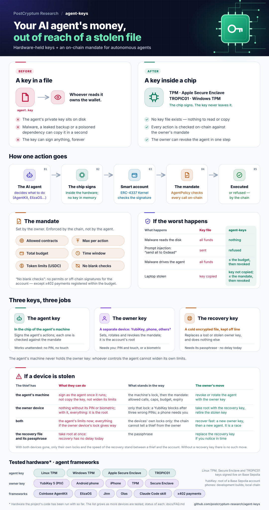

# agent-keys

**Generated in the chip. Seen by no one. Bound by the owner.**

No seed phrase and no file: each agent's key is generated inside its own chip and works nowhere else. The
agent spends only within the limits its owner sets, enforced on chain.

[](#license)
[](https://github.com/postcryptum-research/agent-keys/actions/workflows/gitleaks.yml)


[](#status)

<picture>
  <source media="(prefers-color-scheme: dark)" srcset="docs/img/how-it-works-dark.svg">
  
</picture>

## What you get

- **No key file.** The agent's key is generated inside a TPM 2.0, an Apple Secure Enclave or a TROPIC01. It
  cannot be read or copied: not by malware, not by you.
- **Limits the chain enforces.** The owner sets a mandate: which contracts and functions, how much per action,
  a budget, a time window, token limits. Anything else is refused on chain, whatever the agent is told to do.
- **One step to stop it.** The owner revokes the agent, or replaces its key, in one transaction.
- **The owner's key on a separate device.** A YubiKey today; phone apps exist as development builds. The
  agent's machine never holds it.
- **A cold recovery key.** It can replace a lost owner key and do nothing else.
- **On top of the agent stack you have.** Coinbase AgentKit, ElizaOS, Olas, Jinn, a Claude Code skill, x402
  payments ([`examples/`](examples/README.md)).

**What you do not get yet:** an external audit, and a mainnet deployment. It is testnet only today: see
[Status](#status).

## See it work

A run on Base Sepolia with the agent's key in a Mac's Secure Enclave, from the record in
[`docs/SECURE_ENCLAVE.md`](docs/SECURE_ENCLAVE.md). Options that only name the config and the `.env` are left
out of the commands.

**1. The key is made inside the chip.** Only its public half ever comes out.

```console
$ agent-signer key create --enclave tpm_sign-demo
{
  "key": "tpm_sign-demo",
  "x": "0x37b8e8aa2ca3bef1522e1b27d16c23454b3beae195562f67ac631952d95c2cd9",
  "y": "0x3cc90d6478511e3007b6d28870ba854d9490ddf209a1ca8b455760ef17b177d3"
}
```

**2. The agent acts within its mandate.** It increments a counter, and the operation is included
([the transaction](https://sepolia.basescan.org/tx/0xc431bafe3588431c82b96aac7318c3c4340e16be784322bba5d801f3a401300c)).

```console
$ agent-signer demo
path:           permission (agent key)
gas paid by:    the account
userOpHash:     0x0893b341617b0b849fd55a683d8095ae544e0d7fcba92564405cf3b798f84cfc
delivery:       self-bundled via handleOps
included: tx 0xc431bafe3588431c82b96aac7318c3c4340e16be784322bba5d801f3a401300c (block 48414001, 664572 gas)
counter:  26 -> 27
```

**3. A prompt injection asks for one wei to an outsider.** The policy refuses it (`PolicyFailed(0)`), and no
gas is spent.

```console
$ agent-signer op send --target 0x000000000000000000000000000000000000dEaD --wei 1
path:           permission (agent key)
Error: EntryPoint rejected the operation: AA23 reverted (op 0), inner revert 0x3e4983f60000000000000000000000000000000000000000000000000000000000000000
```

## In technical terms

An AI agent (or any unattended process) signs its on-chain actions with a key
that lives in a secure element — a TPM 2.0 on Linux or Windows, a Tropic
Square TROPIC01, Apple's Secure Enclave — and never exists as a file. Its account is an
ERC-4337 smart account that verifies the chip's **P-256** signature on-chain
through the RIP-7212 precompile. No secp256k1 key, no MPC, no custodian: the
only on-chain owner is the public key of the chip.

Why a smart account and not a plain EOA: every secure element speaks NIST
P-256 and none speaks secp256k1, which an EOA needs. Account abstraction
removes that wall: the chip stays a P-256 signer, and the account checks its
signature itself.

## Quick start

No hardware is needed: a software backend stands in for the chip, for development and CI only. The blocks
continue one another, so paste them in order.

**Get the code**, with the contracts' dependencies:

```sh
git clone --recurse-submodules https://github.com/postcryptum-research/agent-keys
cd agent-keys
```

**Test the signer**, and the core it shares with the phone apps (a crate outside the signer's workspace):

```sh
cd signer && cargo test
cd ../mobile/owner-core && cargo test
```

**Run the CLI end to end** on a local anvil: the real CLI against EntryPoint, Kernel, our modules, a Safe, a
paymaster, a fake bundler and an x402 server. The keys are software keys, which only this test-only build
accepts.

```sh
cd ../../signer
cargo test -p agent-signer --features insecure-software-keys --test anvil_cli
```

**Test the contracts.** From Foundry 1.8 the P-256 precompile (RIP-7212) comes with the Osaka EVM:

```sh
cd ../contracts && forge test --evm-version osaka
```

An older Foundry runs plain `forge test`: the config enables the precompile there with `odyssey = true`.

Linux with a TPM, the `vector` command and the other platforms:
[`docs/GETTING_STARTED.md`](docs/GETTING_STARTED.md#quick-start).
An account of your own on Base Sepolia, step by step:
[`docs/GETTING_STARTED.md`](docs/GETTING_STARTED.md#run-an-agent-account-on-base-sepolia).

## If the worst happens

| What happens | A&nbsp;key&nbsp;in&nbsp;a&nbsp;file | agent-keys |
|---|---|---|
| Malware reads the disk | all&nbsp;funds&nbsp;gone | nothing of the account's — its keys are not in files |
| Prompt injection: "send everything to 0xdead" | sent | refused on-chain, unless the mandate allows that transfer — then at most its limits |
| Malware takes over the agent itself | all&nbsp;funds&nbsp;gone | at most what the mandate allows, until the owner revokes the agent |
| The laptop is stolen | the&nbsp;key&nbsp;is&nbsp;copied | the key cannot be copied out of the chip; a thief who gets the machine running can sign as the agent, held to the mandate, until the owner revokes ([more](docs/HOW_IT_WORKS.md#if-a-device-is-stolen)) |

More, including a stolen device: [`docs/HOW_IT_WORKS.md`](docs/HOW_IT_WORKS.md).

## Status

> [!WARNING]
> **No external audit yet.** The reviews so far are internal, not a professional third-party audit
> ([`docs/FAQ.md`](docs/FAQ.md#is-it-audited)). agent-keys runs on a test network, Base Sepolia, and holds no
> real funds. A third-party audit comes before any mainnet funds; until then, use it at your own risk.

What runs today, phase by phase and backend by backend, with the transactions:
[`docs/STATUS.md`](docs/STATUS.md).

## Docs

New here? Start with [`docs/HOW_IT_WORKS.md`](docs/HOW_IT_WORKS.md) — the idea on one page. [`docs/FAQ.md`](docs/FAQ.md) walks through two setups (a Linux
laptop with $100, a Mac with a scheduled $100k budget) and common questions;
[`docs/AGENT_CONFIG.md`](docs/AGENT_CONFIG.md) specifies the agent config file
and how it maps to what the contracts enforce.
See [`docs/ARCHITECTURE.md`](docs/ARCHITECTURE.md) for the design and
[`docs/BENCHMARK.md`](docs/BENCHMARK.md) for what each authorization method
costs — P-256 through RIP-7212 is as cheap as `ecrecover`, and the whole
agent path adds about 79k gas per operation.
How this compares with what else exists — old-phone signers such as Cake
Wallet's Cupcake, hosted agent-wallet platforms, passkey accounts and the
nearest open-source projects: [`docs/related/`](docs/related/README.md).

## Examples

Open-source agent stacks with their wallet layer — a key file or a custodial
wallet — replaced by a hardware-signed agent account. All of them go through
one seam, `agent-signer op send --json` (x402 payments through
`agent-signer x402 fetch`); details in
[`examples/README.md`](examples/README.md).

[Coinbase AgentKit](examples/agentkit/) · [Claude Code / OpenClaw skill](examples/claude-skill/) ·
[Jinn](examples/jinn/) · [Olas](examples/olas/) · [ElizaOS](examples/elizaos/) · [x402](examples/x402/).
What each one changes and what it showed on Base Sepolia:
[`examples/README.md`](examples/README.md#what-each-example-shows-on-base-sepolia).

## Reference

Y. Madhwal, *Integrating Secure Elements with Account Abstraction for
Autonomous IoT Blockchain Agents* (Skoltech research seminar, 2026) — the same
design with an ATECC608A; this project generalizes it to the TPM / Secure
Enclave in ordinary machines and to AI agents.

## License

The repository is under two permissive licenses, by directory:

| Path | License | Files |
|---|---|---|
| `signer/` — `hw-signer`, `agent-signer`, the Swift shim | Apache-2.0 | [`signer/LICENSE`](signer/LICENSE), [`signer/NOTICE`](signer/NOTICE) |
| everything else — `contracts/`, `examples/`, `scripts/`, `legacy/`, `docs/` | MIT | [`LICENSE`](LICENSE) |

The signer is Apache-2.0 for its explicit patent grant and contribution
terms, which matter for security software adopted by companies; versions
published before the change were MIT and stay available under MIT. The
contracts stay MIT so that any account, module or framework can import them,
and their SPDX headers match the verified on-chain sources. Contributions are
accepted under the license of the directory they change. Third-party code —
the git submodules under `contracts/lib`, crates and npm packages — keeps its
own license.

## Contributing · Security · Contact

Improvements and fixes are welcome: [CONTRIBUTING.md](CONTRIBUTING.md) has the build, the tests and what a
pull request needs.

Report a vulnerability privately through the [security policy](SECURITY.md), not in a public issue.

To talk about the project, or about keeping an agent's funds within limits with it, reach out on
[Telegram @kupermind](https://t.me/kupermind).

[](https://postcryptum.io) [](https://x.com/PostCryptumHQ) [](https://t.me/kupermind)
