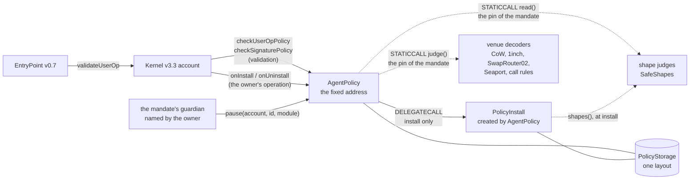
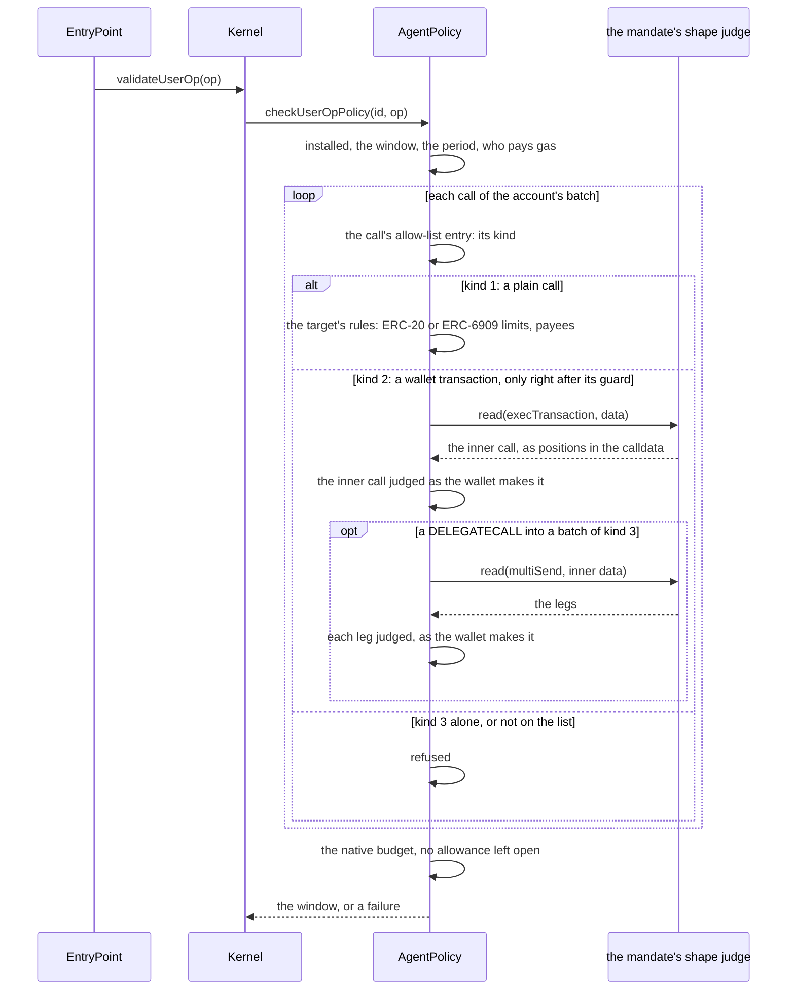
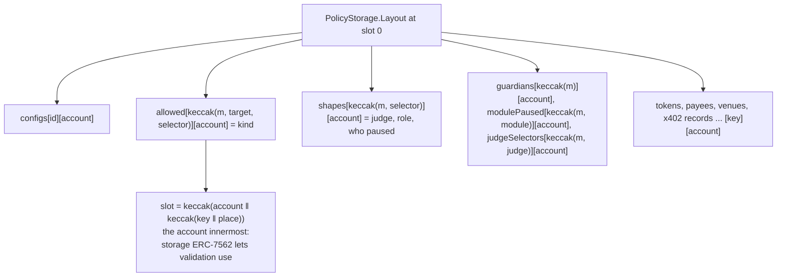

# Architecture: hardware-held P-256 keys + ERC-4337 smart accounts

## Why the project pivoted

TPM 2.0, Apple Secure Enclave, Windows Platform Crypto Provider and WebAuthn
passkeys all expose hardware-protected ECDSA keys on **NIST P-256
(secp256r1)**. None of them support secp256k1, and an Ethereum EOA is
secp256k1 + `ecrecover`. There is no recovery id `v` for a P-256 signature,
so a hardware key can never own an EOA. The original prototype hit exactly
this wall (`git log`: `f6e2874 "my laptop don't have a secp256k1 in TPM
2.0"`; `legacy/src/sign.py: compute_eth_v` tried secp256k1 recovery over a
P-256 signature).

So we stop trying to make the chip own an EOA. **The chip stays a P-256
signer; the account becomes a smart account** whose `validateUserOp` verifies
P-256 against the enrolled `(Qx, Qy)`. The bundler signs the outer transaction
with its own secp256k1 key — the chip never touches that curve.

What made this viable now: the RIP-7212 precompile brings on-chain P-256
verification from ~300k gas (pure Solidity) to ~3.4k. It is live on Base,
Optimism and other OP-Stack chains, Polygon, zkSync, Scroll and Linea, and
reaches mainnet via EIP-7951 (Osaka).

Reference design: Y. Madhwal, *Integrating Secure Elements with Account
Abstraction for Autonomous IoT Blockchain Agents* (Skoltech research seminar,
October 2026). It uses an ATECC608A on a Raspberry Pi with a P256 smart
account, a whitelist paymaster and a telemetry logger. We generalize it in two
directions: the secure element is the TPM / Secure Enclave already present in
general-purpose machines, and the "device" is an AI agent.

## Goals

- The agent's signing key never exists as a file. It is generated inside the
  hardware and never exported. A TPM key is persisted at a handle inside the
  chip; the only key blobs on disk are the Secure Enclave's per-label files,
  wrapped by the enclave and useless outside it (the `key.priv` blobs were
  the legacy prototype's).
- No third party holds signing authority. The sole on-chain owner of the
  account is the owner's public key — a hardware key, or, for the owner and
  the recovery key only, an encrypted key file on removable media
  (`docs/KEY_POLICY.md`). No MPC, no custodial gateway. The
  bundler and paymaster are untrusted infrastructure: they can delay or drop
  a request, they cannot forge one or move funds. A bundler does propose the
  gas figures the hardware signs, and is paid from them; the CLI takes them
  only up to twice its own estimate and twice the node's `maxFeePerGas`, and
  refuses anything beyond before signing ([#148](https://github.com/postcryptum-research/agent-keys/issues/148)).
- Cross-platform. One account, one trait, one backend per platform.

## Threat model for an agent

Hardware custody is not trusted intent. The chip signs any 32-byte digest the
host presents, so a compromised or misbehaving agent process can ask it to
sign a malicious operation and the chip will comply. For a sensor that means a
forged reading; for an agent with funds it means a drained account.

Therefore the **smart account's policy is the containment boundary**:

| Control | Enforced by | Protects against |
|---|---|---|
| Key cannot be copied or extracted | TPM / Secure Enclave | key theft, impersonating the agent from another machine |
| Per-operation value cap and a total budget per permission (time-windowed permissions make a schedule) | account policy module | a compromised host draining the account |
| Target contract / selector allow-list | account policy module | the agent acting outside its mandate |
| Session keys with TTL and budget | Kernel permission (`P256Signer` + `AgentPolicy`) | the agent holding root authority at all times |
| Rotation / revocation under a separate factor | account root path | losing control when a host is retired or breached |

Chip and policy answer different questions. The chip guarantees nobody else
can be this agent. The policy guarantees that even this agent, compromised,
cannot exceed what it was allowed to do. Together they provide what MPC
providers sell as a service, without the provider.

## System

```
 host (Linux / macOS / Windows)                  chain (Base Sepolia → L2s)
 ┌────────────────────────────────┐              ┌───────────────────────────────┐
 │ agent (LLM or workflow)        │              │ EntryPoint (ERC-4337)         │
 │   │ intent → UserOperation     │   bundler    │   │                           │
 │   ▼                            │ ───────────▶ │   ▼ validateUserOp            │
 │ agent-signer (Rust)            │              │ P256 smart account            │
 │   │ userOpHash                 │              │   • P256 validator (RIP-7212) │
 │   ▼                            │              │   • policy / session keys     │
 │ HardwareSigner trait           │              │   ▼ execute                   │
 │   ├ tpm            (Linux)     │              │ target contract               │
 │   ├ secure-enclave (macOS)     │              │                               │
 │   ├ windows-tpm    (Windows)   │              │ Paymaster (sponsors gas)      │
 │   └ software       (dev/CI)    │              └───────────────────────────────┘
 └────────────────────────────────┘
```

The diagram shows the first backends; the table below lists them all. The
device need not hold the native token: a paymaster sponsors eligible
operations, following the reference design. An account may also pay its own
gas (`account fund`); the policy then counts each operation's maximum gas
cost against the budget.

## The policy on chain, in parts

`AgentPolicy` grew past what one contract may hold (24,576 bytes; #224),
so it is being divided (#251), step by step, each step measured. The goal:
one policy at one address for good, and every part that may change, or be
switched off, outside it. This section describes the division as it
stands in the source; nothing of it is deployed yet, and the test networks
keep the earlier, whole policy until it is
([`DEPLOYMENTS.md`](DEPLOYMENTS.md)). Contract by contract:
[`CONTRACTS.md`](CONTRACTS.md).

### The parts and who calls them



| Part | What it is | Called | Changes how |
|---|---|---|---|
| `AgentPolicy` | the policy Kernel knows: validation, the ERC-1271 answer, x402 and orders, the ERC-20 and ERC-6909 rules, the native budget, periods, the per-operation sums | by the account | a new policy at a new address, which every owner rotates to; the part kept small and stable for that reason |
| `PolicyInstall` | the install of a mandate: its five forms, the judges' pins, the allow-list and its kinds, the limits; naming a guardian and pausing a module | by `AgentPolicy`, by DELEGATECALL, in the owner's or the guardian's call | with the policy, which creates it in its constructor |
| `PolicyStorage`, `PolicyRules` | one storage layout, and the keys and rules both of the above apply; libraries, compiled into both | — | with them |
| shape judges (`IShapeJudge`; `SafeShapes`) | where the calls inside a wallet transaction or a batch lie | by `AgentPolicy`, static call, in validation | a new judge is a new contract; a mandate pins it; the policy does not change |
| venue decoders (`IVenueDecoder`) | what an order or a call at a venue costs and its digest | by `AgentPolicy`, static call, in validation | the same |

No part is reached through an address in storage that someone could
change: the policy's own parts are fixed in its code, and every judge is
pinned by the owner in the mandate, by address and code hash.

### Validation of one operation



A judge answers positions, and the policy slices its own calldata at
them, only within it, and judges what it slices. The judge also names each
call's target, value and kind (a call or a DELEGATECALL), and those the
policy takes from it as they are: what the policy judges is what the wallet
runs as far as the judge reads the wallet honestly. That trust is part of
the mandate, which is why the owner pins the judge by address and code
hash, and why `SafeShapes` is held to the Safe's own decoding by tests. A
judge reads no storage. One that reverts makes the operation's validation
revert, a refusal for the mandate that pinned it and no other. A wallet
transaction is paired with the Safe's nonce guard (`SafeNonceAssert`); a
judge for another kind of wallet would need a guard of its own, which is
not built.

### Install of a mandate

```mermaid
sequenceDiagram
    participant O as the owner: phone or owner key
    participant K as Kernel
    participant AP as AgentPolicy
    participant PI as PolicyInstall
    participant J as each pinned shape judge
    O->>K: a root operation: installValidations
    K->>AP: onInstall(id ‖ mandate)
    AP->>PI: DELEGATECALL onInstall
    PI->>J: shapes(), its code hash checked against the pin
    J-->>PI: the selectors it reads, each with its role
    PI->>PI: each selector pinned to one judge, never one the policy owns (no data, the token functions it meters, its own entry points), eight at most; the judge's selectors recorded for pause
    PI->>PI: the allow-list with each entry's kind; a Safe transaction or a batch without its judge refused
    PI->>PI: token limits, payee lists, period and venues, id limits
    PI-->>AP: all of it written in AgentPolicy's storage
```

The owner's phone reads the same mandate before signing and refuses what
the policy would refuse: it names each judge as verified in its build, by
address and code hash, and refuses one it does not know
([`MOBILE_OWNER_DESIGN.md`](MOBILE_OWNER_DESIGN.md)).

### Switching a module off

```mermaid
sequenceDiagram
    participant O as the owner, through the account
    participant G as the mandate's guardian
    participant AP as AgentPolicy
    participant PI as PolicyInstall
    O->>AP: setGuardian(id, guardian), in the install's operation or later
    AP->>PI: DELEGATECALL: the guardian kept for this mandate
    G->>AP: pause(account, id, module, true)
    AP->>PI: DELEGATECALL: the guardian or the account only
    PI->>PI: the caller's bit set for this mandate (the owner's or the guardian's): a shape judge's in each pin recorded at install, a venue decoder's beside its pin; the module itself is not called
    Note over AP: validation: a paused module's calls are refused, the rest of the mandate runs
    G->>AP: pause(account, id, module, false): clears the guardian's bit only
    O->>AP: pause(account, id, module, false): clears both
```

The guardian can stop a module of one mandate of one account and lift its
own stops, and nothing more: it never lifts what the owner paused, it widens
nothing, and the owner removes it with `setGuardian(id, 0)`. A pause holds
two bits, the owner's and the guardian's, and validation refuses while
either is set. `pause` finds a judge's pins from the selectors recorded at
install and does not call the judge, so a judge cannot keep itself from
being paused. A pause of a venue reaches its orders registered before it,
too: an order's record names its venue by a tag (80 bits of the venue's
pause key, in the record's first slot), and the account vouches for no
order whose venue is paused, so the venue cannot settle it until the pause
is lifted. The flag is in the account's slots, so validation may
read it (a shape judge's flag shares its pin's slot and costs nothing; a
venue decoder's costs one slot on venue operations). There is no flag for
everyone at once: validation may not read one, and so a module is stopped
for each account that pinned it ([#251](https://github.com/postcryptum-research/agent-keys/issues/251),
decision 2). A new installation of the id starts with no guardian and
nothing paused. Two other levers stay: the owner rotates the module out of
the mandate, and a phone build that no longer lists a module refuses every
mandate that pins it.

The owner's side: `permission guardian` and `permission pause` in the CLI
send both calls from the account, each tried from the account before the
owner signs; `permission rotate` names the old permission's guardian for
the new one in the same operation, and pauses there each module the old
mandate had paused and the new one pins, as the owner's pause, so a
rotation keeps both; `permission show` names the guardian and what is paused
([`AGENT_CONFIG.md`](AGENT_CONFIG.md)). The owner's phone reads both calls
on a policy its build knows to have them, and shows a guardian named or
removed, a pause lifted, and a pause for another account's mandate as rows
that stand out; it refuses a guardian call placed before a change of the
account's validators in the same operation, which would apply to the
mandate the operation replaces; on any other policy both stay calls it
cannot read
([`MOBILE_OWNER_DESIGN.md`](MOBILE_OWNER_DESIGN.md)).

### Storage, and what validation may read



In validation a contract the account calls may touch only storage
associated with the account (ERC-7562: `keccak(account ‖ x) + n`). So
every value sits under a key with the account innermost, and nothing the
policy reads in validation is global: no implementation slot, no module
registry, no pause flag. That is why the division pins judges in each
mandate rather than in a registry, and why a module is switched off per
account (#251, decision 2).

### What it costs

Measured on the source, against the whole policy before the division [V
`test_measure_validationGas_*`, `test_measure_installGas` in
`contracts/test/AgentPermission.t.sol`, 2026-11-28]:

| | Before | Now |
|---|---|---|
| `AgentPolicy` size | 24,437 bytes | 19,554 (`PolicyInstall` 12,409, `SafeShapes` 2,844) |
| validation: a plain call | 34,313 gas | 34,474 |
| a token transfer | 41,946 | 42,107 |
| a Safe transaction | 42,703 | 47,989 |
| a Safe `multiSend` of two legs | 60,213 | 73,258 |
| an install of two entries and a token limit | 178,346 | 188,979 |

What moved out of validation costs nothing there; what a judge reads costs
a slot, a cold call and the copy of the calldata, paid only by the
mandates that use it. Every operation pays about 150 gas for the check of
whether its mandate names the native token's ERC-20 face (the next
section); one that names it pays a slot more.

### One budget where the native token is an ERC-20 too

On Arc, USDC is the gas token (18 decimals) and the ERC-20 at
`0x3600000000000000000000000000000000000000` (6 decimals): two doors to one
balance. A mandate may name that ERC-20 as the native token's face, in the
fourteen-word install form, by token and decimals. What the mandate's limit
of that token charges in an operation (transfers, approvals, x402 payments,
orders) then counts against the native cap per operation and the native
budget too, scaled to 18 decimals, with the value sent and the gas: one
budget bounds all of it. Validation adds the token's total for the
operation once, at its end, from the sum the token limit already keeps, so
no path that charges the token is missed. Naming a face only adds a limit:
the policy takes any of the mandate's limited tokens, and the owner's
phone takes only the face its build knows for the chain, at its decimals.
An x402 payment that is reclaimed gives its charge back to the token's
budget, not to the native one. The steps, and what was measured at each, are on
#251.

## The signer trait

`signer/crates/hw-signer` defines the only platform-specific seam:

```rust
pub trait HardwareSigner {
    fn public_key(&self) -> Result<PublicKey, SignerError>;        // (x, y)
    fn sign_digest(&self, digest: &[u8; 32]) -> Result<Signature, SignerError>; // (r, s), low-s
    // defaults: a chip signs the operation's hash and needs nothing more
    fn sign_user_op(&self, ctx: &UserOpContext<'_>) -> Result<Signature, SignerError>;
    fn needs_request(&self) -> bool;
}
```

A digest goes in, `(r, s)` comes out. That is all a chip sees; a signer with
a human behind it (the owner's phone) refuses bare digests and receives the
whole operation as an `owner-core` sign request, shows it, and signs only
what it showed. Everything above it — UserOperation
building, signature packing, bundler I/O — is platform-neutral. Backends are
cargo features so a machine compiles only the one it has:

| Feature | Platform | Mechanism | Status |
|---|---|---|---|
| `software` | all | in-memory `p256` key — **dev/CI only**, never for a funded account | done |
| `tpm` | Linux | TPM 2.0 via `tss-esapi`; keys created under the SRK (`0x81000001`), transient or persisted | done |
| `secure-enclave` | macOS | Secure Enclave via CryptoKit (Swift shim); the enclave-wrapped key blob is kept in a file per label — no keychain entitlements needed | done — run on an Apple M1 Mac (2026-10-21): hardware test, vector `p256_enclave.json` verified by the Solidity tests, and an account with both keys in the enclave on Base Sepolia — see `docs/SECURE_ENCLAVE.md` |
| `windows-tpm` | Windows | TPM 2.0 via CNG's Platform Crypto Provider, keys by name | done — run on a Windows 11 PC: hardware test, key in the TPM, vector `p256_windows.json` verified by the Solidity tests — see `docs/WINDOWS.md` |
| `tropic01` | any (USB) | Tropic Square TROPIC01 USB DevKit — an open-architecture secure element; P-256 keys generated in an ECC slot, one secure session per operation over the vendor's Rust SDK (`tropicsquare/libtropic-rs`) | done — hardware test, vector `p256_tropic01.json`, and an agent operation on Base Sepolia — see `docs/TROPIC01.md` |
| `yubikey-piv` (`yubikey` in `agent-signer`) | any (USB) | YubiKey 5 PIV slot over PC/SC; keys are generated with ykman, the PIN is asked at use | done — vector `p256_yubikey.json` — see `docs/YUBIKEY.md` |

Two key holders are not cargo features of `hw-signer`: an encrypted key file
(`agent-signer/src/keyfile.rs`; owner and recovery keys only) and the
owner's phone (`agent-signer/src/phone.rs` with the shared core
`mobile/owner-core`; vector `p256_android.json`; `docs/MOBILE_OWNER_DESIGN.md`).

Signatures are normalized to low-s off-chip: `(r, n − s)` is equally valid,
RIP-7212 accepts either, and the Solady verifier rejects high-s to kill
malleability.

## Repository layout

```
signer/        Rust workspace: hw-signer (trait + backends), agent-signer (CLI)
contracts/     Foundry: P256 validators (root, recovery), permission signer,
               agent policy, Safe nonce assertion, paymaster, demo targets
               (the account itself is ZeroDev Kernel); tests consume JSON
               vectors produced by the Rust CLI
mobile/        phone owner apps (android, ios) and their shared Rust core
               (owner-core), which the CLI also uses
examples/      agent framework integrations
scripts/       helper scripts
docs/          this document and design notes
legacy/        legacy Python prototype (src/, tests/) — kept as reference
               until the Rust CLI reaches parity, then removed
```

Secrets (RPC URLs, the testnet gas wallet) live **outside** the repository
in `../.env` and `../gas-wallet.key`. `.gitignore` refuses `.env`,
`.env.*` and `*.key` if they are ever copied in; keep them outside the
repository all the same.

## Development

Any platform — software backend, no hardware needed:

```sh
cd signer && cargo test
cd contracts && forge test --evm-version osaka
# The P-256 precompile (RIP-7212) comes with the Osaka rules (forge 1.8 or
# later): without the flag every P-256 check fails (AA24). CI runs forge 1.10.0.
```

Linux — TPM backend:

```sh
sudo apt install libtss2-dev libclang-dev    # ESAPI headers + bindgen
sudo usermod -aG tss "$USER"                 # access to /dev/tpmrm0; re-login
cd signer
cargo test --features tpm -- --ignored       # signs inside the TPM
cargo run -p agent-signer --features tpm -- vector --backend tpm --message hello
```

The system `tpm2-tss` must be 4.1.5 or later, or 4.2.1 or later: thirteen
advisories were published from 2026-10-26 to 2026-11-04, some in the ESAPI
library the backend links ([`THIRD_PARTIES.md`](THIRD_PARTIES.md)).
`pkg-config --modversion tss2-esys` gives the installed version; a
distribution's package may carry the fixes under an older number, which its
security notices say.

Lessons that cost real debugging time:

- Talk to `/dev/tpmrm0` (kernel resource manager, group `tss`), never raw
  `/dev/tpm0` (root-only, single client).
- `ReadPublic` and `TR_FromTPMPublic` have no auth area. Run them with
  `execute_without_session`; under the password session tpm2-tss 4.0.1 returns
  `TPM_RC_HANDLE`, and with the crate's pre-generated bindings it segfaulted.
- Build `tss-esapi` with `generate-bindings` so bindgen targets the installed
  tpm2-tss 4.x headers.
- The signing key must be *unrestricted*: a restricted key refuses to sign a
  host-computed digest without a TPM hash-check ticket.
- Kernel permission ids must be *clean* 4-byte values. `bytes4(keccak256(…))`
  leaves the rest of the hash as dirty low-order bits, and
  `ValidatorLib.permissionToIdentifier` ORs the raw word in assembly: the
  permission installs under `0x02 ‖ id ‖ garbage`, the nonce encodes
  `0x02 ‖ id ‖ 0…0`, and every operation fails the allowed-selector check
  with `InvalidValidator()` after the signer has already passed.

## Roadmap

- **Phase 0 — prove the primitive. Done (2026-10-20).** Vectors signed by the
  software backend and inside a TPM 2.0 (Intel PTT) both verify on-chain
  through RIP-7212 in `forge test`; a `P256.verifySignature` call costs about
  11k gas including test overhead. The secp256k1-recovery path in
  `legacy/src/sign.py` is obsolete.
- **Phase 1 — on-chain.** *1a done (2026-10-20):*
  `contracts/src/P256Validator.sol`, an ERC-7579 validator on ZeroDev Kernel
  v3.3. `forge test` runs the full ERC-4337 path — EntryPoint v0.7 →
  `KernelFactory.createAccount` → Kernel → validator → `execute` — with a
  P-256 signature, and the committed TPM vector passes the validator.
  *1b done (2026-10-20):* the agent key as a Kernel *permission* instead of
  root — `contracts/src/P256Signer.sol` (`ISigner`) plus
  `contracts/src/AgentPolicy.sol` (`IPolicy`): single-call `execute` only,
  (target, selector) allow-list with `0x00000000` for plain transfers, value
  cap per operation, total budget, hard expiry enforced by the EntryPoint via
  `validUntil`, and ERC-1271 refused so the agent cannot sign permits or
  orders off-chain. `forge test` covers allowed/denied targets and selectors,
  cap and budget, expiry, and that the agent key is rejected on the root
  path while the owner key is not. Permission signature format:
  `0xff ‖ r ‖ s`; nonce key: `0x00 ‖ 0x02 ‖ id(4) ‖ 0×16 ‖ nonceKey(2)`.
  Today `AgentPolicy` also accepts a batch `execute` (default exec type),
  holds a time window `[validAfter, validUntil]` and per-token limits,
  passes calls through an owned Safe, refuses the account, its EntryPoint
  and itself as targets, and makes one ERC-1271 exception: registered x402
  authorizations (`docs/ERC1271.md`).
  In the source, not deployed
  ([#80](https://github.com/postcryptum-research/agent-keys/issues/80)):
  a budget per period, and trading. The agent does not call a venue. It
  registers an order with the policy; the policy asks the venue's decoder
  (`contracts/src/venues/`, a contract with no storage, read by `STATICCALL`
  and pinned by its code hash) whether the order is within the owner's
  terms, charges what it sells to the token's limits, and the account then
  vouches for exactly that order when the venue asks, until the order ends.
  The venue takes the tokens through an allowance the owner gives with the
  mandate. A new venue is a new decoder; the policy does not change. The
  policy may not read the clock during validation, so an operation names
  its period and the policy answers with that period's window, which the
  EntryPoint enforces; across a renewal up to two budgets can be spent in a
  short time, and the phone says so (`docs/AGENT_CONFIG.md`,
  `docs/FUZZING.md`). The first live order, on Sepolia through CoW Swap:
  `docs/TRADING_WALKTHROUGH.md`.
  *1c done:* `script/Deploy.s.sol` deploys the three modules and a demo
  target through the canonical CREATE2 deployer (salt 0) and records them in
  `deployments/<chainid>.json`; Kernel v3.3, its factory and EntryPoint v0.7
  are ZeroDev's and eth-infinitism's canonical deployments. Today the script
  also deploys `P256RecoveryValidator`, `SafeNonceAssert` and
  `WhitelistPaymaster`. The file also records `solc` and `evmVersion`: the
  compiler settings of `foundry.toml` with which the instances under the
  unversioned names were built, so that their code can be rebuilt and
  compared (issue #123; `test/DeploymentsRecord.t.sol` holds the script,
  `foundry.toml` and each chain's file equal). [V] Compared on chain for Base
  Sepolia on 2026-11-24 (the instances then current, now kept under
  versioned names), against a build of commit `175acbf3a3127e804a45a3e4dd097165f0a4c922` with solc 0.8.38
  and `cancun` (master has moved ahead since, `VERSION` among the changes):
  - `P256Validator`, `P256RecoveryValidator`, `P256Signer` and
    `SafeNonceAssert` equal byte for byte;
  - `AgentPolicy` and `WhitelistPaymaster` equal outside their immutable
    slots, which hold `0xC14AbFF54D40f4DAf665391E0B7079bd53EB8279` and the
    EntryPoint `0x0000000071727De22E5E9d8BAf0edAc6f37da032`;
  - `DemoCounter` was deployed before metadata was turned off. Its code is
    that build's followed by solc's metadata (solc 0.8.34): the same code,
    at another address than a fresh CREATE2 of that build.
- **Phase 2 — off-chain. Done (2026-10-20).** `agent-signer` derives the
  account from the two hardware public keys and the mandate (`agent.*.json`),
  builds the `PackedUserOperation` with `alloy`, fetches `userOpHash` from the
  EntryPoint, signs it through the `HardwareSigner` trait, frames the
  signature for the root or the permission path, and submits
  `EntryPoint.handleOps` itself from a gas wallet — no bundler, no paymaster,
  no custodian. (Today the hash is computed locally by `owner-core` and
  compared with `EntryPoint.getUserOpHash` before anything is signed.)
  First on-chain run on Base Sepolia: account
  `0xEdB645B14e2f952C5784e34949b58F0826fBc9E9`, tx
  `0x785332105fd8085d50e542ff9f677eba964399bbc0d71333ddd71fed03e669bb`
  (deploys the account and executes the agent's call in one operation).
  Lessons: `alloy`'s `abi_encode()` on a dynamic tuple prepends an offset
  word — use `abi_encode_params()` for `abi.encode(a, b, c)`; public RPC
  replicas lag behind the one that returned the receipt, so post-inclusion
  reads are pinned to the receipt's block; simulate `createAccount` before
  funding a counterfactual address.
- **Phase 3 — operations.**
  - *3.1 Secure Enclave backend — done (2026-10-21).* Written on CryptoKit
    (2026-10-20), then run on an Apple M1 Mac: the Swift shim built
    unchanged, the hardware test passed, the enclave signed the vector
    `p256_enclave.json`, and an account whose owner and agent keys both live
    in the enclave executed an agent operation and a root operation on Base
    Sepolia. `docs/SECURE_ENCLAVE.md` is the procedure plus the run record.
  - *3.2 Paymaster — done (2026-10-20).* `contracts/src/WhitelistPaymaster.sol`
    on eth-infinitism's `BasePaymaster` v0.7.0: the sponsor keeps a deposit
    in the EntryPoint and lists the accounts it pays for; sponsorship and
    authorization stay separate checks. Deployed on Base Sepolia at
    `0xe314e95bef9b891c48429aD127D79e601240BB52`; a sponsored agent
    operation (tx `0xae73b53d17b74ad8c7b6d65f8cc98abd40c513a808b09764828dff8a3a5f2106`)
    left the account's balance untouched. `agent-signer paymaster
    deposit|sponsor` and `--sponsored` on `op send` / `demo`. Today that
    address is recorded as `whitelistPaymasterV1`; the current paymaster
    (`whitelistPaymaster` in `deployments/84532.json`,
    `0x657792557C1D40f2Da031FD7aB277078D2c0a4cb`) gives each account a gas
    budget and a per-operation cap (`paymaster sponsor --budget
    --max-per-op`), and `paymaster stake` exists.
  - *3.3 done (2026-10-20).* **Rotation and revocation:** root operations
    signed by the owner key — `permission revoke` uninstalls the agent
    permission; `permission rotate` replaces it in one batch (uninstall the
    old id, `installValidations` the one the config describes, grant
    `execute`), with the install nonce derived from Kernel's rule
    (`currentNonce()`, plus one when re-installing the same id). The config
    pins the deployed `account` so a changed mandate or key describes the
    *next* permission, not a new address. **PCR sealing:** `key create
    --pcrs 0,2,4,7` creates a key whose auth policy is `TPM2_PolicyPCR`
    over those registers with `userWithAuth` cleared; signing opens a policy
    session with an empty digest so the TPM compares the registers' current
    values itself, and refuses once the measured boot state changed (the
    hardware test seals to the resettable PCR 16, extends it, sees the refusal,
    resets it). On Base Sepolia: rotation `agnt → agn2` to a sealed key, tx
    `0x4519a35b5acdc19ffe713326964b5214677825d11040684f9869adbd8b195370`;
    the sealed key's first sponsored operation, tx
    `0xc8117420694a9c17d3c91a14df3ce70f00298d2bc0fcd38f55997c1bfc75db4b`.
  - *3.4 done (2026-10-20): gas benchmark* — `docs/BENCHMARK.md`,
    `contracts/test/GasBenchmark.t.sol`. P-256 verification via RIP-7212
    costs the same as `ecrecover` (7,433 vs 7,402 gas), so hardware keys
    carry no gas penalty; the full agent path (real EntryPoint, Kernel,
    policy + signer, paymaster) added about 77k gas per operation at that
    date, about 79k with the policy deployed on 2026-11-21; large payloads
    are dominated by data cost, as the paper found.
  - *3.5 done (2026-10-20): bundler RPC as a drop-in.* `--bundler <url>` or
    `BUNDLER_URL` routes an operation through an ERC-4337 bundler: the
    operation is serialized in the v0.7 unpacked form, the bundler's
    `eth_estimateUserOperationGas` replaces our limits (the hash covers them,
    so the hardware signs a second time), `eth_sendUserOperation`, then
    `eth_getUserOperationReceipt` until inclusion. (Today the estimate runs
    with a placeholder signature, so the hardware signs once, over the final
    gas fields — a second time only if the bundler raises its fee floor.)
    Pimlico's public endpoint
    (no key, 20 requests/minute) accepted an agent operation and included
    it. That shows delivery, not conformance to ERC-7562: this endpoint was
    later found to enforce none of the validation rules on Base Sepolia, and
    a rule-enforcing bundler refuses the storage layout of the `AgentPolicy`
    deployed that day ([#83](https://github.com/postcryptum-research/agent-keys/issues/83); the instance deployed on 2026-11-21 has the
    layout that passes, with the account as the innermost key of every
    mapping). The
    operation: tx
    `0xb42e30ae72ac8d676c33198b65ae85e8ef06936d15b28cda5832ed4cc0527675`,
    paid from the account's EntryPoint deposit; the gas wallet took no part.
    A *sponsored* operation went through the same way (tx
    `0x59b2814afc86bd161cd0ebf8abb96824a881746375881fabc686bb17c4c2539f`):
    the chip signs, the paymaster pays, the bundler relays — no gas wallet
    anywhere in the path. Trust does not change: a bundler can delay or
    drop, not forge or redirect; the gas figures it proposes are bounded
    (see the first section). Pimlico's public testnet endpoint relayed
    from an unstaked paymaster; bundlers with default ERC-7562 reputation
    rules require a staked one (`paymaster stake`).
  - **TROPIC01 backend — done.** `hw-signer/src/tropic01.rs`; the owner
    (TPM) rotated the agent permission `agn2 → trp1` onto the key in ECC
    slot 1 of a TROPIC01 USB DevKit (tx
    `0x44bb4d6625e5ff3548273fc2f3009eb4e30fde333da8a78ef6fa74d8809bb133`),
    and the chip signed a sponsored agent operation under `AgentPolicy`
    (tx `0x6c1060b43c1a40e3d123fe766adad914edccac8e9596cc1dc658617cf53622b5`).

  Lessons from 3.3: a fixed `callGasLimit` is a trap — an execution phase
  that runs out of gas reverts with *no data*, the outer `handleOps`
  still succeeds and the sponsor pays; `agent-signer` now estimates the
  execution as a call from the EntryPoint and treats
  `UserOperationEvent.success == false` as failure. `cast run` replays in a
  local EVM without RIP-7212 unless given `--evm-version osaka`, so it shows
  `AA24 signature error` for operations the chain accepted; use it only
  with the flag, or trace the execution calldata with `cast call --from
  <EntryPoint> --trace`, where no signature is involved.

  Lesson from 3.2: solc's metadata hash embeds compiler settings, so adding
  remappings changed every contract's creation code and the deploy script
  minted a second, unused set of modules
  (`0xA3DFEebc75623266beBBA9fEAEd8Df7Cd0cceE97`,
  `0x492E57EEB529338b0c48b5e8Be52508E5AeE6267`,
  `0xFA85F816a6698C9725dad58919054067E41391E8`,
  `0x617D8f2e2039265558cF7e8Ecb311480a227a5f5`). Bytecode is now
  metadata-free (`bytecode_hash = "none"`, `cbor_metadata = false`) and the
  script reuses addresses recorded in `deployments/<chainid>.json` whenever
  they hold code.
- **Phase 4 — gas benchmark** on Base Sepolia, mirroring the reference paper's
  measurements with a TPM in place of the ATECC608A.

## License

`signer/` is Apache-2.0 (`signer/LICENSE`, `signer/NOTICE`); contracts,
docs, examples, scripts and legacy are MIT (`LICENSE`); `mobile/` is
pending. Dependencies keep their own licenses: Solady (MIT), ZeroDev Kernel
(MIT), alloy (MIT / Apache-2.0), tss-esapi (Apache-2.0).
