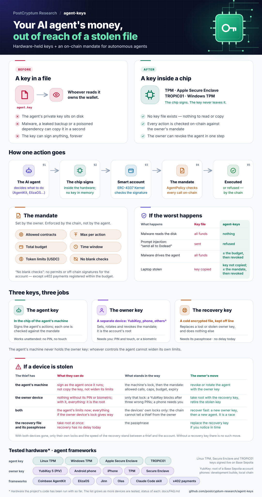

# How it works — on one page

<picture>
  <source media="(prefers-color-scheme: dark)" srcset="img/how-it-works-dark.svg">
  
</picture>

## The short version

**Before.** An AI agent that moves money usually holds a private key in a
file — a `.env`, a keystore, a config. Whoever can read that file owns the
wallet: malware, a leaked backup, a poisoned dependency, a tool the agent
was tricked into running. And the key can sign anything, forever.

**After.** With agent-keys there is no key file. The agent's key is generated
inside a chip — a TPM, an Apple Secure Enclave or a TROPIC01 — and never
leaves it; the chip signs, the agent only asks. The agent acts through a
smart account (ERC-4337), and every action is checked **on-chain** against
a mandate its owner set: which contracts and functions it may call, how
much per action, a total budget, a time window, token limits. Anything
outside the mandate is refused by the chain itself — whatever the agent,
or whoever controls it, asks for.

## How one action goes

1. **The AI agent** decides what to do (in AgentKit, ElizaOS, Jinn, Olas, a
   Claude Code skill, …).
2. **The chip signs** the operation inside the hardware — no key in memory,
   none on disk.
3. **The smart account** (a ZeroDev Kernel) checks that signature.
4. **The mandate** (`AgentPolicy`) checks every call — and, for a Safe, the
   call inside it.
5. **The chain executes it, or refuses it.**

## If the worst happens

| What happens | A&nbsp;key&nbsp;in&nbsp;a&nbsp;file | agent-keys |
|---|---|---|
| Malware reads the disk | all&nbsp;funds&nbsp;gone | nothing of the account's — its keys are not in files |
| Prompt injection: "send everything to 0xdead" | sent | refused on-chain, unless the mandate allows that transfer — then at most its limits |
| Malware takes over the agent itself | all&nbsp;funds&nbsp;gone | at most what the mandate allows, until the owner revokes the agent |
| The laptop is stolen | the&nbsp;key&nbsp;is&nbsp;copied | the key cannot be copied out of the chip; a thief who gets the machine running can sign as the agent, held to the mandate, until the owner revokes ([below](#if-a-device-is-stolen)) |

## Three keys, three jobs

| Key | Where it lives | What it does | Needs a person |
|---|---|---|---|
| **agent** | the chip of the machine the agent runs on: a TPM, an Apple Secure Enclave, a TROPIC01 | signs the agent's actions; each one is checked against the mandate | no: it works unattended, with no PIN and no touch |
| **owner** | a separate device: a YubiKey, a phone, another machine's chip (or an encrypted cold file) | sets the mandate, rotates the agent's key and revokes it, each in one transaction; it is the account's root | yes: PIN and touch, or a biometric |
| **recovery** | a cold encrypted file on a USB drive, kept off line | replaces a lost or stolen owner key, and does nothing else | yes: its passphrase |

**Tested hardware so far.** Agent key: a TPM 2.0 on Linux and on Windows, an
Apple Secure Enclave, a TROPIC01. Owner key: a YubiKey 5 (PIV), root of a Base
Sepolia account; an Android phone and an iPhone (development builds, on a
local chain); a TPM and a Secure Enclave. Other devices join the list once
they have been tested; [`FAQ.md`](FAQ.md) has the status of each and
[`OWNER_DEVICES.md`](OWNER_DEVICES.md) the study of the candidates.

The owner key should stay out of reach of the agent's machine; the software
does not enforce where you keep it. The rest stands on that separation:
whoever controls the agent's machine cannot widen the agent's limits.

## If a device is stolen

A stolen device is not a lost one: the thief holds the chip. What that gives
them depends on which key is in it.

| The thief has | What they can do | What stands in the way | What the owner does |
|---|---|---|---|
| the agent's machine | sign as the agent once the machine runs. Not copy the key, and not change the mandate | the machine's own lock: its login and disk encryption. A TPM key sealed to PCRs refuses to sign under another OS, a plain one does not ([`RESILIENCE.md` §1.4](RESILIENCE.md#14-pcr-sealed-keys-by-design)); a Secure Enclave key works only while that Mac is unlocked ([`SECURE_ENCLAVE.md`](SECURE_ENCLAVE.md)). Then the mandate: allowed calls, caps, budget, expiry | revoke or rotate the agent with the owner key, one transaction (`permission revoke`, `permission rotate`) |
| the owner device | nothing without its PIN or biometric. With it, everything: the owner key is the account's root | that lock only. A YubiKey blocks its PIN after three wrong tries ([`YUBIKEY.md`](YUBIKEY.md#setting-a-yubikey-up-once-with-ykman)); a phone asks for the biometric on every use and drops the key when a new biometric is enrolled ([`MOBILE_OWNER_DESIGN.md` §5 and §10, T7](MOBILE_OWNER_DESIGN.md#10-threat-model)) | take root with the recovery key (`owner recover`), hand it to a new owner key and retire the stolen key's validator (`owner set-root --retire`), then check the mandate ([`RECOVERY_DRILL.md`](RECOVERY_DRILL.md)) |
| both | the agent's limits at once; the whole account if the owner device's lock gives way | the devices' own locks and, for the agent's part, the mandate. Nothing on chain tells a thief from the owner | the same, fast: the recovery key makes a new owner key root, and that owner revokes the agent and installs a new one. It is a race against the lock of the owner device |
| the recovery file and its passphrase | take root at once: **recovery has no delay today** | the passphrase; the file is encrypted with scrypt and an AEAD cipher ([`KEY_POLICY.md`](KEY_POLICY.md)) | replace the recovery key if the theft is noticed in time: `owner replace-recovery` with the owner key, after which the stolen file recovers nothing. A delay that the owner can cancel is what [`RESILIENCE.md` §3.4](RESILIENCE.md#34-timelock-on-recovery-recommended-for-a-value-bearing-deployment) recommends before real value; it is not built |

- **With both devices gone, the only things between a thief and the account
  are the devices' own locks and the speed of the recovery.** Once the recovery
  key has made a new owner key root, that owner takes the agent back under
  control.
- **Without a recovery key there is no such move:** a stolen owner device,
  like a lost one, leaves the agent running until its mandate expires and the
  account frozen after that ([`RESILIENCE.md` §2.3](RESILIENCE.md#23-owner-and-recovery-lost-the-dead-account)).

The longer form, with where each statement comes from, is
[`RESILIENCE.md` §2.4](RESILIENCE.md#24-a-device-stolen-not-lost).

## Where to go next

- [`FAQ.md`](FAQ.md) — two worked setups ($100 on a Linux laptop, a $100k
  budget on a schedule on a Mac) and the questions people ask.
- [`KEY_POLICY.md`](KEY_POLICY.md) — what each key may do and where it may
  live; what an attacker with the agent's privileges can and cannot do.
- [`AGENT_CONFIG.md`](AGENT_CONFIG.md) — the mandate, field by field.
- [`TRADING_WALKTHROUGH.md`](TRADING_WALKTHROUGH.md) — one run from an
  empty address to a filled order on CoW Swap, with every transaction.
- [`ARCHITECTURE.md`](ARCHITECTURE.md) — the contracts and the signer.
- [`examples/`](../examples/README.md) — AgentKit, ElizaOS, Jinn, Olas, a
  Claude Code skill and x402 payments on hardware-held keys.
