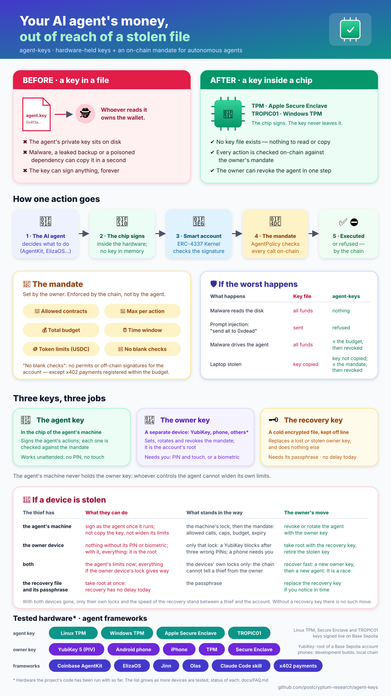

# How it works — on one page

## The short version

**Before.** An AI agent that moves money usually holds a private key in a
file — a `.env`, a keystore, a config. Whoever can read that file owns the
wallet: malware, a leaked backup, a poisoned dependency, a tool the agent
was tricked into running. And the key can sign anything, forever.

**After.** With TPM_sign there is no key file. The agent's key is generated
inside a chip — a TPM, an Apple Secure Enclave or a TROPIC01 — and never
leaves it; the chip signs, the agent only asks. The agent acts through a
smart account (ERC-4337), and every action is checked **on-chain** against
a mandate its owner set: which contracts and functions it may call, how
much per action, a total budget, a time window, token limits. Anything
outside the mandate is refused by the chain itself — whatever the agent,
or whoever controls it, asks for.

## How one action goes

1. **The AI agent** decides what to do (in AgentKit, ElizaOS, Jinn, Olas, a
   Claude Code skill, …).
2. **The chip signs** the operation inside the hardware — no key in memory,
   none on disk.
3. **The smart account** (a ZeroDev Kernel) checks that signature.
4. **The mandate** (`AgentPolicy`) checks every call — and, for a Safe, the
   call inside it.
5. **The chain executes it, or refuses it.**

## If the worst happens

| What happens | A key in a file | TPM_sign |
|---|---|---|
| Malware reads the disk | all funds gone | nothing — there is no key file |
| Prompt injection: "send everything to 0xdead" | sent | refused on-chain |
| Malware takes over the agent itself | all funds gone | at most what the mandate allows, until the owner revokes the agent |
| The laptop is stolen | the key is copied | the key cannot be extracted from the chip; the mandate still applies, and the owner revokes |

## The owner stays in charge

The owner key is separate — in another chip, or an encrypted cold backup on
a USB drive — and never on the agent's machine. It sets the mandate,
rotates the agent's key and revokes it, each in one transaction. A cold
recovery key can take over if the owner device is lost.

## Where to go next

- [`FAQ.md`](FAQ.md) — two worked setups ($100 on a Linux laptop, a $100k
  budget on a schedule on a Mac) and the questions people ask.
- [`KEY_POLICY.md`](KEY_POLICY.md) — what each key may do and where it may
  live; what an attacker with the agent's privileges can and cannot do.
- [`AGENT_CONFIG.md`](AGENT_CONFIG.md) — the mandate, field by field.
- [`ARCHITECTURE.md`](ARCHITECTURE.md) — the contracts and the signer.
- [`examples/`](../examples/README.md) — AgentKit, ElizaOS, Jinn, Olas, a
  Claude Code skill and x402 payments on hardware-held keys.
